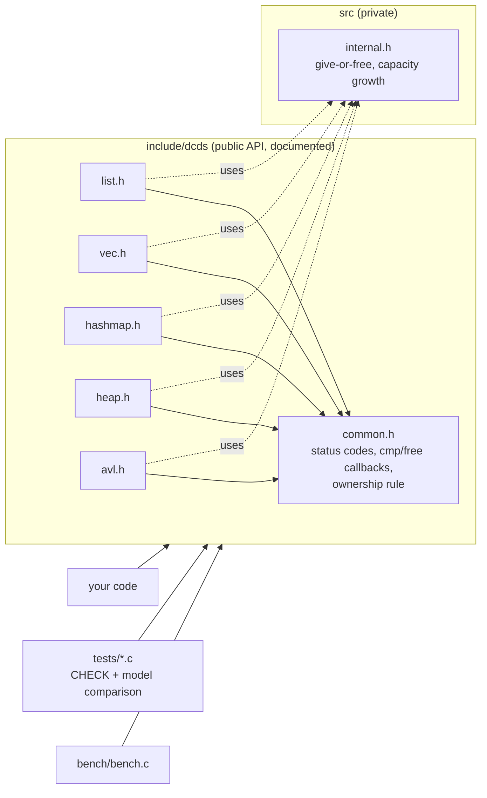
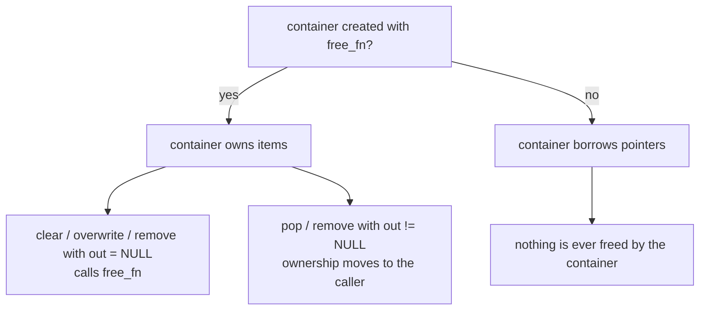

# c-data-structures


A small, documented C17 library of the data structures every C program ends up needing: **doubly linked list, dynamic array, string-keyed hash map, binary heap and AVL tree**. Built by **DCtech.** as an engineering reference: strict warnings, sanitizers, valgrind, static analysis, coverage and reproducible benchmarks are all enforced in CI, so every claim below has a check behind it.

> No dependencies beyond libc. Not thread-safe. Not a replacement for a mature container library; read [Limitations](#limitations) first.

## The problem

C ships no containers, so each project rewrites them, usually with the same bugs: an off-by-one in a resize, a leak on the error path, a delete that corrupts the tree, a hash table that loops forever once it fills with tombstones. This repository writes them once, with a single ownership rule, documented complexity in every header, and tests that compare each structure with a trivially correct model on thousands of random operations.

## What is inside

| Module | Header | Structure | Main operations (n = size) |
|---|---|---|---|
| list | [`dcds/list.h`](include/dcds/list.h) | doubly linked list | push/pop both ends O(1), unlink known node O(1), find O(n), reverse O(n) |
| vec | [`dcds/vec.h`](include/dcds/vec.h) | growable array, capacity doubles | get/set O(1), push amortised O(1), insert/remove at index O(n) |
| hashmap | [`dcds/hashmap.h`](include/dcds/hashmap.h) | open addressing, linear probing, FNV-1a, tombstones, 75 % load cap | put/get/remove expected O(1), worst case O(n) |
| heap | [`dcds/heap.h`](include/dcds/heap.h) | binary min-heap (priority queue) | push O(log n), pop O(log n), peek O(1) |
| avl | [`dcds/avl.h`](include/dcds/avl.h) | self-balancing ordered map | insert/find/remove O(log n) worst case, in-order traversal O(n), `validate` for tests |

Items are `void *` and every container follows one ownership rule ([ADR 0001](docs/adr/0001-void-pointer-containers-and-ownership.md)): with a free function the container owns its items; anything returned through an `out` pointer is handed to the caller; a `NULL` `out` releases the item. Allocation failures and size overflows are reported as `DCDS_ENOMEM` and leave the container unchanged.

## Run it (one command)

```sh
make test              # builds and runs every unit test (needs a C17 compiler and make)
make test SAN=1        # same, with AddressSanitizer + UndefinedBehaviorSanitizer
make test CC=clang     # pick the compiler
make example           # runs examples/quickstart.c
make bench             # prints the benchmark table for your machine
```

CMake (the integration path for another project):

```sh
cmake -S . -B build -DDCDS_SANITIZE=ON && cmake --build build && ctest --test-dir build --output-on-failure
```

```cmake
add_subdirectory(c-data-structures)
target_link_libraries(my_app PRIVATE dcds)   # exports the include/ directory
```

## Example

[`examples/quickstart.c`](examples/quickstart.c) counts words in a hash map, lists them alphabetically through an AVL tree and pulls the most frequent two out of a heap. CI builds it with both compilers and runs it under valgrind.

```c
dcds_hashmap counts;
dcds_hashmap_init(&counts, free);                  /* the map owns the entry structs */
entry *e = dcds_hashmap_get(&counts, word);
if (e == NULL) {
    e = calloc(1, sizeof *e);
    if (e == NULL || dcds_hashmap_put(&counts, word, e) != DCDS_OK) { /* handle ENOMEM */ }
}
e->count++;
```

Output of `make example`:

```text
alphabetical:
  cat    2
  mat    1
  on     1
  sat    1
  the    3
top 2:
  the    3
  cat    2
```

## Architecture





## What CI enforces

| Check | Tool | Where |
|---|---|---|
| Warnings are errors: `-Wall -Wextra -Wpedantic -Wshadow -Wconversion` | gcc, clang | `make test` matrix |
| Memory errors and undefined behaviour abort the run | AddressSanitizer + UBSan (`-fno-sanitize-recover=undefined`) | gcc and clang |
| Leaks and invalid accesses on an unsanitized build | valgrind memcheck (`--error-exitcode=1`) | `valgrind` job |
| Static analysis | cppcheck, clang-tidy (`.clang-tidy`, warnings are errors) | `static-analysis` job |
| Line coverage of `src/` at least 90 % | gcov + lcov | `coverage` job (last run: 95.9 % lines, 100 % functions, 87.6 % branches) |
| Build through CMake and run with CTest | cmake, ctest | `cmake` matrix |
| No secrets in the full history | gitleaks (pinned release, sha256-verified download) | `gitleaks` job |
| Code scanning | CodeQL | runs once the repository is public |

Tests: 5 executables, about 380 000 `CHECK`s per run (most of them inside the randomised tests). Each structure is compared with a trivially correct model (a plain array, a presence table, counts) on tens of thousands of random operations with a fixed seed, and the AVL tree runs its invariant checker (`dcds_avl_validate`) during the run. [ADR 0002](docs/adr/0002-minimal-test-framework.md) explains the small test header; [ADR 0005](docs/adr/0005-ci-layout.md) explains the CI layout.

## Benchmarks

Measured by CI on the merge commit [`0025453`](https://github.com/dc-tech-inc/c-data-structures/commit/00254538a5dabcb38465917b85b58888e2ab5cb5) ([run 39812027174](https://github.com/dc-tech-inc/c-data-structures/actions/runs/39812027174), job `bench`). **Machine:** GitHub-hosted `ubuntu-latest` runner, Linux 7.0.0-1017-azure x86_64, AMD EPYC 9V45 96-Core Processor, shared and unpinned. **Compilers:** gcc 13.3.0 and Ubuntu clang 18.1.3, both `-O2`. 200 000 random 64-bit keys, 5 timed runs after one warm-up, median, nanoseconds per operation.

| Benchmark | What is timed | gcc 13.3.0 | clang 18.1.3 |
|---|---|---:|---:|
| vec push | append N items, includes growth | 2.1 | 1.4 |
| vec scan | read N items by index | 0.9 | 0.9 |
| list push_back | N node allocations | 3.9 | 4.6 |
| list scan | walk N nodes | 2.6 | 2.5 |
| hashmap put | N string keys, includes rehash and key copies | 169.0 | 223.5 |
| hashmap get | N hits | 67.0 | 98.8 |
| heap push+pop | N pushes then N pops (heapsort) | 159.4 | 176.0 |
| avl insert | N random keys | 388.5 | 649.9 |
| avl get | N hits | 154.4 | 316.5 |
| libc `qsort` | reference: sort the N keys once | 86.2 | 86.2 |

How to read this honestly:
- These are single runs on a shared virtual machine; the CPU model even changes between CI jobs (an earlier run of the same code landed on an EPYC 7763 with different numbers). Differences of tens of percent between rows or between compilers are within noise; orders of magnitude are not.
- Vector and list items point into one pre-built array, and list nodes are allocated back to back, so their scans are friendlier to the cache than a long-lived, fragmented list would be.
- `make bench` prints the same table with your machine and compiler in the header. The full output of each CI run is in its job summary and in the `bench-results` artifact.
- Hash map keys are strings and are copied on insert; that is most of the `put` cost.

## Technical decisions

- [ADR 0001](docs/adr/0001-void-pointer-containers-and-ownership.md): containers of `void *` with one ownership rule.
- [ADR 0002](docs/adr/0002-minimal-test-framework.md): a small test header instead of Unity or greatest.
- [ADR 0003](docs/adr/0003-avl-over-red-black.md): AVL for the ordered map.
- [ADR 0004](docs/adr/0004-open-addressing-hash-map.md): open addressing with tombstones, bounded load.
- [ADR 0005](docs/adr/0005-ci-layout.md): what CI checks and why.

References: ISO/IEC 9899:2018 (C17); [AddressSanitizer / UBSan](https://clang.llvm.org/docs/AddressSanitizer.html); [Valgrind Memcheck](https://valgrind.org/docs/manual/mc-manual.html); [gcov](https://gcc.gnu.org/onlinedocs/gcc/Gcov.html); FNV hash ([draft-eastlake-fnv](https://datatracker.ietf.org/doc/html/draft-eastlake-fnv-17)); Adelson-Velsky and Landis, *An algorithm for the organization of information* (1962).

## Limitations

- **Not thread-safe.** No locking; do not touch one container from two threads.
- **The hash map is not hash-flood resistant.** FNV-1a is unkeyed, so an attacker who controls keys can force collisions and degrade operations to O(n). Do not feed it untrusted keys where that matters.
- **Only string keys** in the hash map; the AVL tree takes any key through a comparator.
- **`void *` containers.** No type checking, and one pointer of indirection per item.
- **No iterators that survive modification.** The tree and map expose callbacks (`foreach`); the list exposes its nodes; mutating during traversal is undefined.
- **Allocator is `malloc`.** There is no allocator hook, and allocation-failure paths are covered by reasoning and review, not by fault injection tests yet.
- **Benchmarks are noisy** (shared CI hardware) and measure these implementations only; they are not a comparison with other libraries.
- Developed and tested on Linux with gcc and clang; Windows/MSVC and macOS are not in CI.

## Roadmap

See the open issues: a keyed hash for the map, fault-injection tests for allocation failures, and macOS plus MSVC in the CI matrix. A tagged release (v0.1.0) follows once those land.

## Em português

Biblioteca em C17 com lista duplamente ligada, vetor dinâmico, tabela hash (chaves string), heap binário e árvore AVL. Cada estrutura tem complexidade documentada no header, regra única de posse da memória, testes que comparam com um modelo simples em milhares de operações aleatórias, e o CI roda gcc e clang com `-Werror`, ASan/UBSan, valgrind, cppcheck, clang-tidy, cobertura e gitleaks. Os números de benchmark do README vêm do CI, com máquina e compilador anotados. Rode tudo com `make test`.

## License

MIT, see [LICENSE](LICENSE). Contributions: [CONTRIBUTING.md](CONTRIBUTING.md). Vulnerability reports: [SECURITY.md](SECURITY.md).
